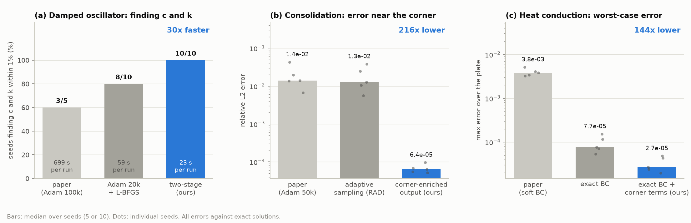
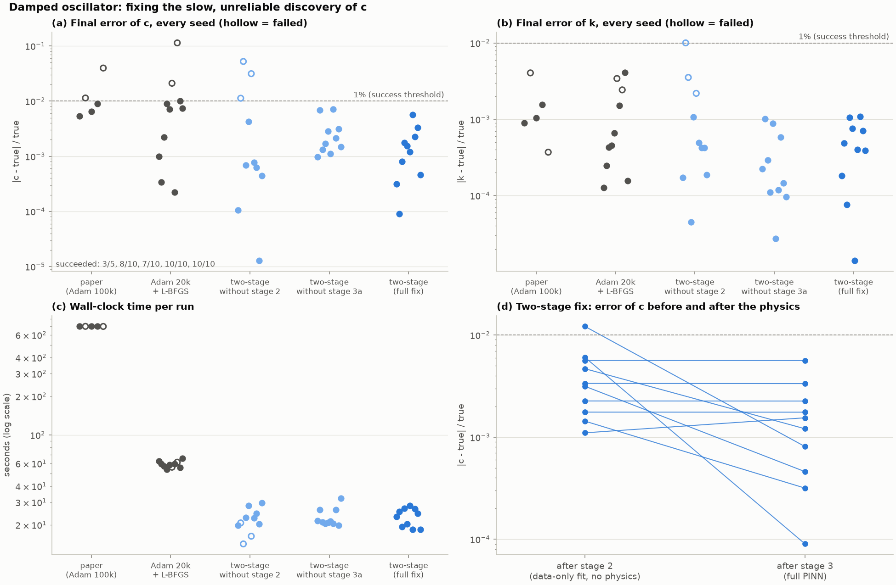
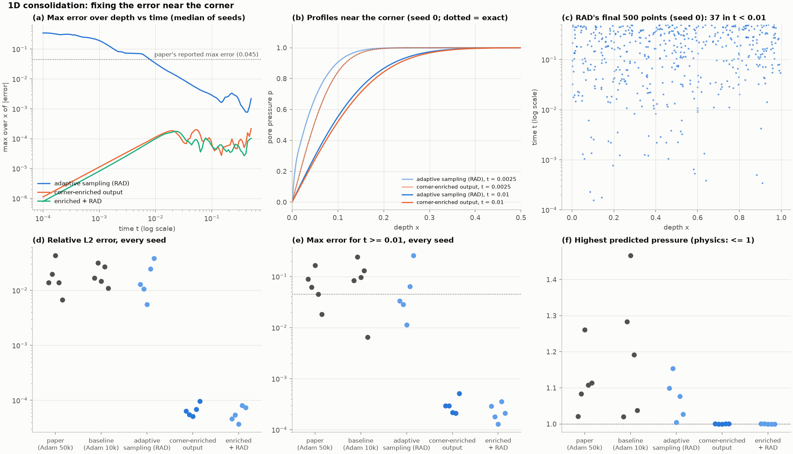
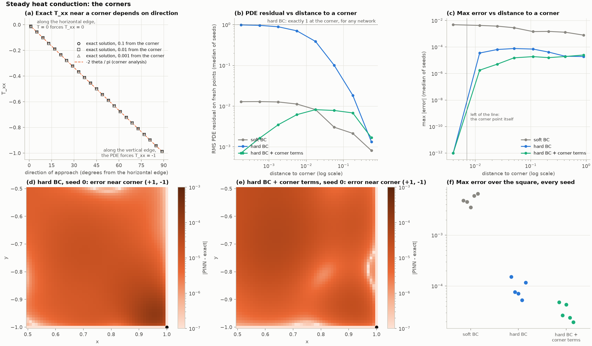
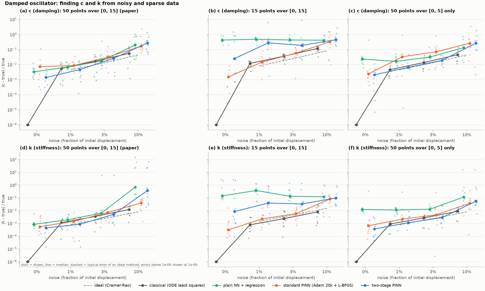
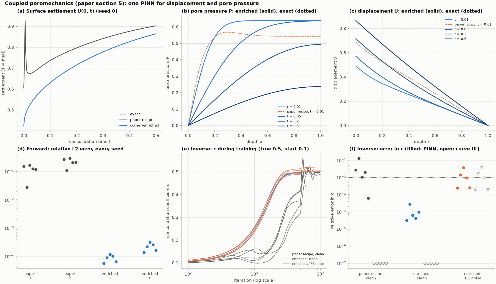

<div align="center">

# Physics-Informed Neural Networks for Mechanics

### Reproducing a PINN study, finding where it fails, and fixing it


**Daruru Bhuvan Sai** (PES1UG24AM356) · **Vismay H S** (PES1UG24AM325)
UE24CS352A Machine Learning · PES University

[**Write-up (2 pages)**](report/writeup/writeup.pdf) · [**Full report (PDF)**](report/PINN_Mechanics_Report.pdf) · [Results](#results-at-a-glance) · [Quick start](#quick-start) · [**Live demo**](#live-demo) · [Reproduce](#reproducing-every-result) · [Code structure](#repository-structure)

<br>



</div>

## Highlights

- **Reproduced all three experiments** of the base paper over 5–10 random seeds each, against exact solutions.
- **Implemented the paper's future work** (§5): one PINN for the coupled poromechanics equations, as a forward problem and as discovery of the consolidation coefficient from settlement readings.
- **Found the cause of each remaining error.** It is a slow-to-learn tail, a corner where the solution jumps, and corners where no smooth network can satisfy the physics.
- **Fixed every one.** The fixes give 10/10 reliable parameter discovery at 30x the speed, about 200x lower error in consolidation, and about 140x lower worst-case error in heat conduction.
- **Tested what the paper didn't:** noisy and sparse data, against a classical fit and the theoretical best (the Cramer-Rao bound).
- **Fully reproducible.** There are 57 unit tests run in CI on Linux and Apple Silicon, seeded runs that are bit-identical on the same machine, and one script per result.
- **Live demo.** `python demo.py` replays the paper's method against our fix on all four problems, about a minute each on a laptop.

## Contents

1. [Background](#background)
2. [Results at a glance](#results-at-a-glance)
3. [Damped oscillator: finding c and k](#1-damped-oscillator-finding-c-and-k)
4. [Consolidation: the error at the corner](#2-consolidation-the-error-at-the-corner)
5. [Heat conduction: edges, then corners](#3-heat-conduction-edges-then-corners)
6. [Noisy and sparse data](#4-noisy-and-sparse-data)
7. [Coupled poromechanics: the paper's future work](#5-coupled-poromechanics-the-papers-future-work)
8. [Conclusions](#conclusions)
9. [Deviations from the paper](#deviations-from-the-paper)
10. [Quick start](#quick-start)
11. [Live demo](#live-demo)
12. [Reproducing every result](#reproducing-every-result)
13. [Repository structure](#repository-structure)
14. [Design decisions](#design-decisions)
15. [References](#references)

## Background

**What a PINN is.** A physics-informed neural network learns a function that obeys a differential equation. Automatic differentiation gives the network's derivatives, so the equation's residual $r$ can be evaluated at any point. Training minimises that residual together with the boundary, initial-condition and data misfits:

```math
\mathcal{L} \;=\; w_{\text{PDE}}\,\overline{r^{2}} \;+\; w_{\text{BC}}\,\overline{(N-g)^{2}} \;+\; w_{\text{IC}}\,\overline{(N-u_0)^{2}} \;+\; w_{\text{data}}\,\overline{(N-u_{\text{obs}})^{2}}
```

In an *inverse* problem, unknown physical constants are trained alongside the weights.

**The base paper.** Zhang, Chen and Yang, *Data Driven Solutions and Discoveries in Mechanics Using Physics Informed Neural Network* (Stanford CS229), apply PINNs to three problems. They report a single run of each. We asked three questions:

- Does the result hold across seeds?
- Where does the remaining error sit, and why?
- Can it be removed?

## Results at a glance

| Problem (paper section) | Paper's method, reproduced | Our fix | Result |
|:--|:--|:--|:--|
| **Damped oscillator**: find damping *c* and stiffness *k* (4.3) | 3/5 seeds within 1%; 699 s per run | Two-stage warm start | **10/10 seeds; 23 s per run** |
| **Soil consolidation** (4.1) | Relative L2 error 1.4e-2; pressure overshoots to 1.11 | Corner-enriched output | **6.4e-5 (about 200x lower); no overshoot** |
| **Heat conduction** (4.2) | Max error 3.8e-3, on the edges | Exact boundary condition + exact corner terms | **2.7e-5 (about 140x lower)** |
| **Noisy, sparse data** (new) | Not tested | Benchmark vs classical fit and Cramer-Rao bound | **Classical fit wins; PINNs need dense data** |
| **Coupled poromechanics** (§5, future work) | Paper's recipe on the coupled system: pore-pressure error 2.1e-1; *c* found in 1/5 seeds | Corner-enriched displacement and pressure | **2.2e-4 (about 1,000x lower); *c* found in 5/5 seeds** |

All numbers are medians over seeds.

---

## 1. Damped oscillator: finding c and k

```math
u'' + c\,u' + k\,u = 0,\qquad u(0)=u'(0)=1,\qquad t\in[0,15]
```

Fifty measurements of $u$ are given; the true values are $c = 0.4$ and $k = 4$, and training starts from $c = 0.2$, $k = 2$.

**Finding.** With the paper's settings only 3 of 5 seeds find both values within 1%. The parameters always match the curve the network currently draws. That curve is learned from left to right, so its tail stays flat for a long time. A flat tail looks like heavy damping and satisfies the ODE exactly, while the late oscillations that encode $c$ carry only 1% of the data's energy.

**Fix: two-stage warm start.**

1. Fit the data without physics.
2. Read $c$ and $k$ off the fitted curve by least squares on its derivatives.
3. Train the PINN with them frozen.
4. Release them and train jointly.

| Method | Seeds within 1% | *c* error, median (worst) | Time per run |
|:--|:-:|:-:|:-:|
| Paper (Adam 100k) | 3/5 | 9.1e-3 (4.0e-2) | 699 s |
| Adam 20k + L-BFGS | 8/10 | 7.3e-3 (1.1e-1) | 59 s |
| **Two-stage (ours)** | **10/10** | **1.4e-3 (5.6e-3)** | **23 s** |

Ablations show that step 2 is the key ingredient: without it, success falls to 7/10.

<details>
<summary><b>Full figure</b>: every seed, ablations and run time</summary>
<br>

</details>

Code: [`oscillator_reproduce.py`](experiments/oscillator_reproduce.py), [`oscillator_two_stage.py`](experiments/oscillator_two_stage.py) · Tables: [reproduction](results/tables/oscillator_reproduce_summary.md), [fix](results/tables/oscillator_two_stage_summary.md)

## 2. Consolidation: the error at the corner

```math
p_t = p_{xx},\quad 0<x<1,\; 0<t\le 0.5;\qquad p(0,t)=0,\quad p_x(1,t)=0,\quad p(x,0)=1
```

**Finding.** The paper reports a "perfect match". Over 5 seeds the max error is 0.061 (median) and up to 0.166, and the pressure overshoots its physical limit of 1. At $x = 0$, $t = 0$ the exact solution jumps from 1 to 0, an infinitely steep front. The first 2% of the time window holds 11 of the 500 training points but 59% of the squared error. On fresh points the PDE residual is 49, against 5.5e-6 at the training points: the training loss hides the error.

**Fix: corner-enriched output.**

```math
p(x,t) \;=\; \mathrm{erf}\!\left(\frac{x}{2\sqrt{t}}\right) \;+\; x\,t\,N(x,t)
```

The erf term is the exact solution for a layer with no base and carries the jump. The network learns only the smooth correction. We compare it with residual-based adaptive sampling (RAD), the "adaptive re-meshing" that the paper lists as future work.

| Method | Relative L2 error | Highest pressure (limit 1) | Time per run |
|:--|:-:|:-:|:-:|
| Paper (Adam 50k) | 1.4e-2 | 1.108 | 1,143 s |
| Adaptive sampling (RAD) | 1.3e-2 | 1.076 | 395 s |
| **Corner-enriched output (ours)** | **6.4e-5** | **1.000** | **168 s** |

RAD moves points toward the corner, but no placement of points lets a smooth network represent an infinitely steep front.

<details>
<summary><b>Full figure</b>: error over time, profiles near the corner, where RAD puts its points</summary>
<br>

</details>

Code: [`consolidation_reproduce.py`](experiments/consolidation_reproduce.py), [`consolidation_enrichment.py`](experiments/consolidation_enrichment.py) · Tables: [reproduction](results/tables/consolidation_reproduce_summary.md), [fix](results/tables/consolidation_enrichment_summary.md)

## 3. Heat conduction: edges, then corners

```math
T_{xx} + T_{yy} + 1 = 0 \;\text{ on } (-1,1)^2,\qquad T = 0 \;\text{ on the edges}
```

The paper states that no analytical solution exists. A classical series solution does exist; we implement it and verify it with our own finite-difference solver.

**Finding 1: the edges.** The paper enforces $T = 0$ only as a loss penalty. Its largest error lies on the edges, and the plate dips below 0.
**Fix 1:** $T = (1-x^2)(1-y^2)\,N(x,y)$ makes the boundary condition exact. The paper suggests this but does not test it. The error falls about 30-fold.

**Finding 2: the corners.** Along the top edge $T_{xx} = 0$; along the side edge the PDE forces $T_{xx} = -1$. The exact solution resolves this with a direction-dependent value, $T_{xx} \to -2\theta/\pi$, which no smooth network can reproduce. As a result, every exact-boundary network has a PDE residual of exactly 1 at each corner, whatever its weights. Our unit tests check both facts without training.
**Fix 2:** add the exact local solution of a 90° corner, derived by hand, at each corner, so the network learns only a smooth remainder:

```math
u = r^2\left[-\tfrac14 + \tfrac14\cos 2\theta - \tfrac{1}{\pi}\left(\ln r\,\sin 2\theta + \theta\cos 2\theta\right)\right]
```

| Configuration | Relative L2 error | Max error | Residual, fresh / training points |
|:--|:-:|:-:|:-:|
| Paper: soft boundary condition | 1.3e-3 | 3.8e-3 | 2.2x |
| Exact boundary condition | 4.2e-5 | 7.7e-5 | 97.7x |
| **Exact BC + corner terms (ours)** | **3.9e-5** | **2.7e-5** | **1.8x** |

<details>
<summary><b>Full figure</b>: the corner analysis, residual and error vs distance to a corner, error maps</summary>
<br>

</details>

Code: [`heat_reproduce.py`](experiments/heat_reproduce.py), [`heat_corners.py`](experiments/heat_corners.py) · Tables: [reproduction](results/tables/heat_reproduce_summary.md), [corners](results/tables/heat_corners_summary.md)

## 4. Noisy and sparse data

The paper tests parameter discovery only on clean data at 50 points. We ran 4 methods across 3 data settings × 4 noise levels × 10 draws:

- **Data settings:** 50 points; 15 points; 50 points over $t \le 5$ only.
- **Noise levels:** 0, 1, 3 and 10%.
- **Benchmark:** the Cramer-Rao bound, the best accuracy any unbiased method can reach.

| Method | *c* error, 1% noise, 50 points | *c* error, 1% noise, 15 points | Time per dataset |
|:--|:-:|:-:|:-:|
| Ideal (Cramer-Rao bound) | 4.3e-3 | 8.1e-3 | |
| Classical ODE fit | 5.5e-3 | 1.2e-2 | 0.2 s |
| Standard PINN | 8.6e-3 | 1.5e-2 | 61 s |
| Two-stage PINN (ours) | 4.6e-3 | 2.7e-1 | 38 s |

With a known ODE and two parameters, the classical fit is the right tool. The two-stage PINN comes within 7% of the bound on dense data but fails on sparse data. When data stop at $t = 5$, both PINNs extrapolate far better than a plain network.

<details>
<summary><b>Full figure</b>: error vs noise for every method and data setting</summary>
<br>

</details>

Code: [`oscillator_noise.py`](experiments/oscillator_noise.py) · Table: [summary](results/tables/oscillator_noise_summary.md)

## 5. Coupled poromechanics: the paper's future work

The paper ends by proposing to try the coupled poromechanics equations (its Eqs. 5.1–5.2). We solve them in 1D: a soil column loaded on top, drained at the top, resting on a rigid impermeable base. **One network with two outputs**, the soil displacement $U$ and the pore pressure $P$, is trained on the coupled equations exactly as written:

```math
\beta P_t - P_{xx} + \gamma\,U_{xt} = 0 \quad\text{(5.1, fluid mass)},\qquad U_{xx} - \alpha P_x = 0 \quad\text{(5.2, equilibrium)}
```

with $P = 0$ and the load $U_x - \alpha P = -1$ on the drained top, and $U = 0$ and $P_x = 0$ on the base. Here $\alpha = 0.9$ is the Biot coefficient, and $\beta$ and $\gamma$ follow from the soil's stiffness and the fluid's compressibility.

**Exact solution.** Integrating (5.2) gives $U_x = \alpha P - 1$; substituting into (5.1) reduces it to the section 4.1 equation scaled by the loading efficiency $\gamma$. The displacement then has a closed form in iterated error functions, which we derived and cross-checked against a Fourier series. The PINN never sees this reduction.

**Two problems**, matching the paper's two classes:

- **Forward:** find $U$ and $P$ everywhere.
- **Inverse:** find the consolidation coefficient $c$, which sets how fast the soil settles and gives its permeability, from 20 readings of the surface settlement. These are what a geotechnical engineer measures with a settlement plate. The truth is $c = 0.5$; training starts from 0.1.

| Method (5 seeds) | Pore-pressure error, rel. L2 | Displacement error, rel. L2 | Highest pressure (physics: ≤ 0.638) | *c* within 1%, clean readings |
|:--|:-:|:-:|:-:|:-:|
| Paper's recipe ($U = (1-x)N_u$, $P = xN_p$) | 2.1e-1 | 1.2e-1 | 0.674 | 1/5 |
| **Corner-enriched $U$ and $P$ (ours)** | **2.2e-4** | **8.8e-5** | **0.638** | **5/5** (median error 6e-5) |

The same corner that limits section 4.1 limits the coupled problem: the load makes the pressure jump at the drained top, and the displacement's slope jumps with it. Building the erf front into $P$, and the displacement it produces into $U$, lowers the error about 1,000-fold.

**With 1% reading noise**, the enriched PINN finds $c$ within 1% in 3/5 draws (median error 9.3e-3). The classical curve fit, which knows the closed-form settlement curve, gets 9.2e-3 on the same readings, and the two agree within about 0.001 on every draw. The remaining error is set by the noise in the readings, not by the method. The PINN reaches that limit without a closed form, which is what it would need for layered soil or 2D and 3D problems, where none exists.

<details>
<summary><b>Full figure</b>: settlement curves, pressure and displacement profiles, c during training</summary>
<br>

</details>

Code: [`problems/poromechanics.py`](problems/poromechanics.py), [`experiments/poromechanics.py`](experiments/poromechanics.py) · Table: [summary](results/tables/poromechanics_summary.md)

---

## Conclusions

1. **One run is not evidence.** The paper's results hold for only some seeds.
2. **Training loss can mislead.** Near corners the loss looked converged while the equation was badly violated. Residuals on fresh points exposed it every time.
3. **Put known structure in the output, not the loss.** Exact boundary conditions and analytical enrichment beat adaptive sampling and longer training, and the same idea solved the paper's future-work problem.
4. **Warm starts make inverse problems reliable.** The two-stage method went from 3/5 to 10/10 seeds, at 30x the speed.
5. **A PINN is not always the right tool.** It earns its place when data are incomplete and physics must fill the gaps.

**Limitations.** The enrichment terms need analytical insight into each problem. Uncertainty estimates for *c* and *k* are future work. All timings come from one laptop CPU.

## Deviations from the paper

Everything the paper specifies is implemented as stated: network sizes, activations, initialisers, point counts, loss weights, learning rates and optimiser schedules (checked line by line in each `experiments/*_reproduce.py`). Where the paper is silent or we chose differently, it is listed here.

| Where | Paper | This repository | Why |
|:--|:--|:--|:--|
| Framework | DeepXDE (TensorFlow); no code released | Own PyTorch engine (`pinn/`), float64 | Full control over every loss term; L-BFGS needs float64 |
| Runs | One run per problem | 5–10 seeds per configuration | A single run cannot show reliability |
| 4.1 boundary points | 250 on the $x$-boundary | All 250 on $x = 1$ | $p = 0$ at $x = 0$ already holds exactly through the paper's own $x \cdot N$ output |
| 4.1 loss | One boundary loss over BC and IC points, $w_b = 1/4$ | BC and IC terms weighted $\tfrac14\cdot\tfrac{250}{375}$ and $\tfrac14\cdot\tfrac{125}{375}$ | Identical to one average over all 375 points, but each term is logged separately |
| 4.1, 4.2 test sets | 10,011 / 10,000 points | 201 × 201 grid (40,401 points) + 20,000 fresh residual points | Denser; the fresh-point residual exposed errors the training loss hid |
| 4.1, 4.2 output range | Outputs "enforced" to [0, 1] and > 0 (mechanism not described) | No clipping; violations reported (pressure up to 1.108, temperature down to −0.004) | Clipping would hide the error we diagnose |
| 4.2 reference | deal.II finite elements | Classical series solution, checked against our finite-difference solver | Exact, so errors are measured exactly |
| 4.3 time window, start values | Not stated | $t \in [0, 15]$; $c_0 = 0.2$, $k_0 = 2$ | Read off the paper's Fig. 4 |
| 4.3 boundary set | "50 random points" | The initial condition evaluated once at $t = 0$ | For an ODE all 50 points would be the same point |
| §5 poromechanics | 3D equations only, as future work | 1D oedometer form; body force dropped; our own network size and budget | The 1D case has an exact solution to measure against; $\rho_b g$ only sets the initial geostatic state |

## Quick start

**macOS (Apple Silicon, M1–M5)** and **Linux**:

```bash
git clone https://github.com/DBS13062006/pinn-mechanics.git
cd pinn-mechanics
python3.12 -m venv .venv && source .venv/bin/activate   # Mac: brew install python@3.12 first
pip install torch                       # on a Mac this is the native Apple Silicon build
pip install -r requirements.txt         # also installs this repo in editable mode
python scripts/check_env.py             # autograd, seeding and speed checks
python -m pytest                        # 57 tests, under a minute
python demo.py                          # live demo, about a minute per problem
```

> **Use Python 3.10–3.13 (3.12 recommended).** PyTorch publishes builds only for released Python versions it supports; on a newer Python, `pip install torch` fails with "No matching distribution found". `python --version` inside the activated environment shows which one you have.

With `make`: `make setup`, then `source .venv/bin/activate`, then `make test` and `make demo`. Run `make help` for every shortcut.

> **Why the CPU on a Mac?** Every run trains in float64, because L-BFGS needs the precision near convergence. Apple's GPU backend (`mps`) has no float64, so the code uses the CPU, and passing `--device mps` falls back to it with a note. These networks are small enough that the M-series CPU is fast. For the multi-seed studies, `--jobs N` trains N runs in parallel, one per core.

<details>
<summary><b>Other setups</b>: Windows, conda and Google Colab</summary>

**Windows.** Use `.venv\Scripts\activate`. A plain `pip install torch` gives a CPU-only build; for an NVIDIA GPU, install PyTorch with the CUDA command from [pytorch.org](https://pytorch.org/get-started/locally/).

**Conda**

```bash
conda create -n pinn python=3.12 -y && conda activate pinn
pip install torch            # or the CUDA command from pytorch.org
pip install -r requirements.txt
python scripts/check_env.py
```

**Google Colab.** Choose a GPU runtime. The repository is private, so store a GitHub fine-grained token with read access as `GH_TOKEN` in Colab's Secrets panel:

```python
from google.colab import userdata
token = userdata.get("GH_TOKEN")
!git clone https://{token}@github.com/DBS13062006/pinn-mechanics.git
%cd pinn-mechanics
!pip install -q -r requirements.txt
```
</details>

## Live demo

```bash
python demo.py                    # all four problems, one after another
python demo.py oscillator         # or: consolidation | heat | poromechanics
python demo.py --quick            # half the training budget, for a tight time slot
python demo.py all --no-show      # save figures to results/demo/ without opening windows
```

Each problem trains two PINNs from scratch on the same small budget, the paper's method and our fix, and prints every loss term as it trains. It then opens a figure comparing both with the exact solution and prints a verdict such as `relative L2 error: paper method 1.6e-02 -> our fix 2.1e-04 (76x better)`.

| Demo | What the audience sees |
|:--|:--|
| `oscillator` | The paper's joint training still has the wrong damping $c$; the two-stage warm start reads $c, k$ off a data fit and lands on 0.4 and 4. |
| `consolidation` | Pressure profiles near the drained top: the paper's network overshoots 1 and lags the front; the erf-enriched output follows it. |
| `heat` | Error maps on one colour scale: the paper's error lines the edges; ours is near zero everywhere. |
| `poromechanics` | Twenty noisy settlement readings; the enriched coupled PINN recovers the consolidation coefficient $c = 0.5$ from a start of 0.1. |

The demo budgets are far smaller than in `experiments/`, so its numbers vary a little between machines. The multi-seed results above come from the experiment scripts.

## Reproducing every result

Each script writes its figure to `results/figures/`, its tables to `results/tables/` and raw training logs to `results/runs/` (not committed). Run the reproductions first, because each fix reads its baseline from the reproduction's table.

| Study | Command | Runs | Time* |
|:--|:--|:-:|:-:|
| Oscillator: reproduction | `python experiments/oscillator_reproduce.py --device cpu --jobs 5` | 15 | 15 min |
| Oscillator: two-stage fix | `python experiments/oscillator_two_stage.py --device cpu --jobs 5` | 40 | 5 min |
| Oscillator: noisy and sparse data | `python experiments/oscillator_noise.py --device cpu --jobs 4` | 360 | 50 min |
| Consolidation: reproduction | `python experiments/consolidation_reproduce.py --device cpu --jobs 5` | 10 | 29 min |
| Consolidation: enrichment vs RAD | `python experiments/consolidation_enrichment.py --device cpu --jobs 5` | 15 | 13 min |
| Heat: reproduction | `python experiments/heat_reproduce.py --device cpu --jobs 3` | 15 | 82 min |
| Heat: corners | `python experiments/heat_corners.py --device cpu --jobs 3` | 15 | 50 min |
| Coupled poromechanics (§5) | `python experiments/poromechanics.py --jobs 5` | 25 | 11 min† |
| Summary figure | `python report/make_summary_figure.py` | 0 | 1 s |

<sub>*Wall time on an Intel i5-13450HX laptop CPU. †Apple M5 MacBook Air, `--jobs 6`.</sub>

**Options.**

- Every script accepts `--device cpu|cuda`, `--jobs N` and `--quick` (a small smoke test). `make reproduce`, `make fixes` and `make poromechanics` run them in order.
- The reproduction scripts accept `--bench`, which times CPU against GPU.
- The heat and noise studies accept `--resume <run folder>` to continue after an interruption.
- Runs are seeded and record library versions and hardware, so reruns on the same machine are bit-identical.

## Repository structure

```
pinn-mechanics/
├── pinn/                         PINN engine shared by every experiment
│   ├── model.py                  tanh MLP, inputs scaled to [-1, 1], Xavier init
│   ├── derivatives.py            grad, nth_grad, laplacian via autograd
│   ├── train.py                  Adam → L-BFGS trainer, per-term loss logging, divergence guard
│   ├── sampling.py               residual-based adaptive sampling (RAD)
│   ├── metrics.py                relative L2, max error, parameter error
│   ├── plotting.py               shared, colourblind-checked figure style
│   └── utils.py                  seeding, float64 setup, run folders, environment record
├── problems/                     one module per physics problem
│   ├── oscillator.py             exact solution, implied parameters, noisy data, Cramer-Rao bound
│   ├── consolidation.py          Fourier and erfc exact solutions, enriched output
│   ├── heat.py                   series solution, finite differences, exact-BC and corner outputs
│   └── poromechanics.py          coupled Biot equations (5.1)-(5.2), exact U and P, enriched outputs
├── experiments/                  one script per study (see the table above)
├── results/
│   ├── figures/                  one figure per study, plus summary.png
│   └── tables/                   per-run CSV and summary table per study
├── tests/                        57 unit tests: engine, exact solutions, corner facts
├── scripts/check_env.py          autograd, seeding, speed and hardware check
├── demo.py                       live demo: paper method vs our fix, ~1 min per problem
├── report/
│   ├── writeup/writeup.pdf       2-page write-up (LaTeX source alongside)
│   ├── PINN_Mechanics_Report.pdf full project report
│   └── make_summary_figure.py    draws results/figures/summary.png from the tables
├── .github/workflows/tests.yml   CI: tests + demo smoke test on Linux and Apple Silicon
├── Makefile                      make setup | test | demo | reproduce | fixes | writeup
├── pyproject.toml
└── requirements.txt
```

The engine (`pinn/`) knows nothing about any one problem. Each `problems/` module supplies a residual, boundary conditions, exact references and the output transforms (hard boundary condition, enrichment). Each `experiments/` script combines the two and measures the result.

## Design decisions

| Decision | Why |
|:--|:--|
| **tanh activations** | The loss needs second derivatives; ReLU's are zero almost everywhere. |
| **float64 throughout** | L-BFGS needs the precision near convergence. For networks this small, a step costs the same as float32 (12.2 vs 12.6 ms on an RTX 4050). |
| **Adam, then L-BFGS** | Adam leaves the random start; L-BFGS converges. If L-BFGS diverges, the last good weights are restored. |
| **Every loss term logged** | A failure can be traced to the PDE, boundary, initial condition or data term. |
| **Exact references for every problem** | Each reference is cross-checked by an independent method (a second exact solution or a finite-difference solver), so errors are measured exactly. |
| **Residuals on fresh points** | The training loss alone hid the corner errors in both forward problems. |
| **5–10 seeds per configuration** | One shortcut looked perfect on 5 seeds (5/5) and reached only 8/10 on 10. |

## References

1. Q. Zhang, Y. Chen, Z. Yang. *Data Driven Solutions and Discoveries in Mechanics Using Physics Informed Neural Network.* Stanford CS229 project report. **Base paper.**
2. M. Raissi, P. Perdikaris, G. E. Karniadakis. Physics-informed neural networks. *Journal of Computational Physics* 378, 686–707, 2019.
3. I. E. Lagaris, A. Likas, D. I. Fotiadis. Artificial neural networks for solving ordinary and partial differential equations. *IEEE Transactions on Neural Networks* 9(5), 987–1000, 1998.
4. C. Wu, M. Zhu, Q. Tan, Y. Kartha, L. Lu. A comprehensive study of non-adaptive and residual-based adaptive sampling for physics-informed neural networks. *Computer Methods in Applied Mechanics and Engineering* 403, 115671, 2023.
5. D. P. Kingma, J. Ba. Adam: a method for stochastic optimization. ICLR, 2015.
6. D. C. Liu, J. Nocedal. On the limited memory BFGS method for large scale optimization. *Mathematical Programming* 45, 503–528, 1989.
7. K. Terzaghi. *Theoretical Soil Mechanics.* Wiley, 1943.
8. H. S. Carslaw, J. C. Jaeger. *Conduction of Heat in Solids*, 2nd ed. Oxford, 1959.
9. S. P. Timoshenko, J. N. Goodier. *Theory of Elasticity*, 3rd ed. McGraw-Hill, 1970.
10. J. M. Varah. A spline least squares method for numerical parameter estimation in differential equations. *SIAM Journal on Scientific and Statistical Computing* 3(1), 28–46, 1982.
11. S. M. Kay. *Fundamentals of Statistical Signal Processing: Estimation Theory.* Prentice Hall, 1993.

<div align="center">
<sub>Daruru Bhuvan Sai and Vismay H S · UE24CS352A Machine Learning · PES University · 2026</sub>
</div>
